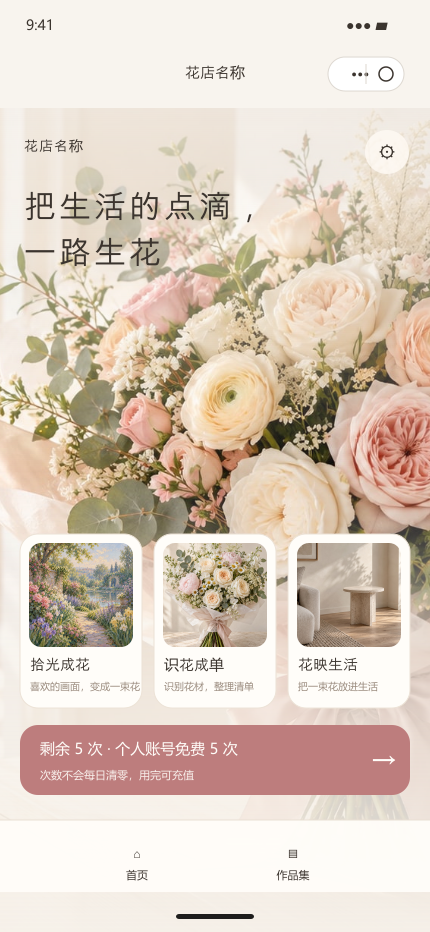

# 花生花艺小程序

House Flower is a WeChat Mini Program for floral inspiration, bouquet creation, material lists, scene previews, and a flower shop portfolio. The client is written in TypeScript/WXML/WXSS; optional cloud workflows use Tencent CloudBase.

> This repository is a source-code project, not a hosted service. CloudBase environment IDs, mini-program AppIDs, model resources, payment credentials, and editorial file IDs are examples or placeholders. Add your own values before connecting a service.

## Preview



This image is a static rendering of the current home layout and sample assets. It does not represent a live API response or a WeChat Developer Tools capture.

## Features

- Shop-branded home page and work portfolio.
- Photo-inspired bouquet creation, flower-material recognition, and scene composition flows.
- Material lists, local work records, cloud task recovery, and quota display.
- CloudBase functions for identity, private uploads, tasks, works, quotas, notifications, maintenance, and optional recharging.

Some cloud features require a CloudBase environment and model credentials. Visual recognition is disabled by default. Payment is not enabled by default.

## Run locally

1. Install Node.js and the WeChat Developer Tools.
2. Install dependencies:

   ```powershell
   npm ci
   ```

3. Open this folder in WeChat Developer Tools. The checked-in project uses the WeChat tourist AppID for local preview. Replace it with an AppID you control before real account or cloud testing.
4. Run the local checks:

   ```powershell
   npm run build
   npm run backend:test
   npm run preview:static
   ```

The app can display its local shell without CloudBase. AI generation, cross-device works, uploads, and account operations require a configured backend.

## Configure CloudBase

1. Create your own CloudBase environment and update `miniprogram/utils/cloud-env.ts` and `cloudbaserc.json`.
2. Create the collections and configure function environment variables described in [CloudBase setup](docs/cloudbase-setup.md).
3. Set `AI_RESOURCES_ENABLED=true` only after you have configured and accepted the model provider and its costs. Keep `AI_VISION_ENABLED=false` unless you have configured a vision model.
4. Editorial images are private by default. Follow [editorial asset setup](docs/editorial-cloud-storage.md) to upload them and generate file IDs for your environment.

No API keys, secrets, user data, or production service identifiers are included intentionally.

## Repository layout

See [architecture](docs/architecture.md) for the main modules and their responsibilities.

```text
miniprogram/       WeChat Mini Program client
cloudfunctions/    CloudBase backend functions
flower-assets/     Source image assets and generated catalogs
scripts/           Asset generation and local validation
docs/              Setup, architecture, and asset notes
```

## License

The source code is licensed under the MIT License. Image and other media files have separate terms; see [ASSET-LICENSES.md](ASSET-LICENSES.md). The code license does not grant rights to third-party artwork, photographs, album covers, or film imagery included as examples.
